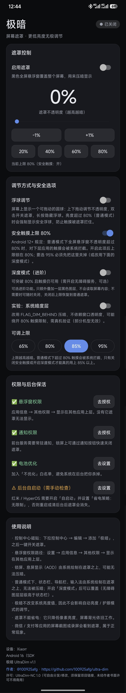

# 极暗 · UltraDim

比系统最低亮度更暗的 Android 压暗工具：不改系统亮度，用一层可调不透明度的黑遮罩继续压暗全屏。

[](https://github.com/100925afg/ultra-dim/releases)
[](#)
[](LICENSE)
[](#)

> **免责声明**
>
> 本软件是免费开源的辅助工具，**按「现状」提供，不附带任何明示或暗示的担保**。使用本软件的全部风险由你自行承担，作者不对任何直接或间接损失负责（包括但不限于屏幕过暗导致的误操作、错过通知或闹钟、设备异常等）。
>
> **请勿在驾驶或骑行时、医疗设备附近、工业控制、紧急呼叫等安全关键场景使用**。屏幕被压暗可能让你看不清内容而误操作；建议始终保留浮球或通知栏「关闭」作为逃生通道。
>
> 本项目与小米 / 红米 / HyperOS / Google / Android 官方**无任何关联**，不是官方应用。使用或分发本软件即表示你已阅读并同意 [LICENSE](LICENSE)；仅本仓库 Releases 发布的是官方版本，第三方修改版与作者无关。



## 使用场景

为您提供更低的亮度，这下妈妈再也不用担心我半夜偷吃闪光弹了！

## 功能

- **无极调节**：0%–80% 连续可调，不改变系统亮度值，退出即恢复
- **深度模式**：开启无障碍服务后可压到 95%，且触摸、状态栏、输入法一起压暗（普通模式受 Android 12+ 触摸规则限制，上限 80%）
- **悬浮球**：拖动调亮度，双击开关，长按隐藏
- **通知与快捷磁贴**：下拉通知栏一键开关，磁贴支持 5% 步进
- **开机恢复**：重启后自动回到上次状态

## 安装

1. 到 [Releases](https://github.com/100925afg/ultra-dim/releases/latest) 下载 `UltraDim-x.y.apk`
2. 手机上允许「安装未知来源应用」后安装
3. 想自己编译？见 [docs/BUILD.md](docs/BUILD.md)

<details>
<summary>用 adb 安装（可选）</summary>

```bash
adb install -r UltraDim-x.y.apk
```
</details>

### 校验下载的 APK（建议）

**只从本仓库的 [Releases](https://github.com/100925afg/ultra-dim/releases) 下载**，其他网站、网盘、群文件里的「极暗」修改版与作者无关。每个 Release 都附 `SHA256SUMS.txt`：

```powershell
Get-FileHash .\UltraDim-x.y.apk -Algorithm SHA256   # 与 SHA256SUMS.txt 对比
```

更可靠的校验是签名证书指纹——v1.2 起官方版本固定为下面这个值，任何人改过包就会变：

```powershell
apksigner verify --print-certs .\UltraDim-x.y.apk
# Signer #1 certificate SHA-256 digest (v1.2 及以后):
# 2cda466a08df81b7f08cd4d0be4c506e82e590a49cb39768a7a130095510ef58
# v1.1 及更早（旧密钥，已停用）:
# a81aefed629f639d5c7edcdea55e4cd17e523fa8c1ad3eb2734b37700e638831
```

> **从 v1.1 升级到 v1.2 需要先卸载旧版**（会清空 App 内设置）。原因是 v1.2 更换了签名密钥——旧版脚本里的密钥口令曾出现在公开仓库中，虽然密钥文件本身从未上传，仍按最坏情况处理。v1.2 起签名固定，以后的版本可以正常覆盖升级。

## 快速上手

1. 打开「极暗」，在「权限与后台保活」里授予**悬浮窗**（显示在其他应用上层）
2. 授予**通知**权限，让前台服务通知常驻
3. 拖动首页滑块或浮球调到你想要的暗度
4. （可选）需要更暗：打开「深度模式」，按提示到系统「无障碍」里开启「极暗」

## 需要注意

- **不改系统亮度**：遮罩只在显示层压暗，退出 App 立刻恢复，不影响系统设置
- **不省电**：屏幕自身亮度不变，只是显示内容变暗
- **会被录屏/截图录进去**：这是「所见即所得」，录屏软件会录制遮罩层，不是软件 bug
- **普通模式盖不住系统状态栏**：系统状态栏属于更高层；深度模式可以盖住
- **HyperOS 额外注意!!!**：「自启动」开启后软件自动保活，会常驻在后台无法杀掉。若感觉影响日常使用请关闭该软件的「自启动」。

## 隐私

**不申请网络权限，不收集任何数据。** 所有设置只存在本机 SharedPreferences 里，卸载即删除。权限逐项用途、数据存储位置与自行验证方法见 [PRIVACY.md](PRIVACY.md)。

## 许可证

允许自由使用、修改、二次分发；分发或发布衍生作品时须保留项目链接 <https://github.com/100925afg/ultra-dim>（署名可选），且未经作者书面许可不得用于商业用途。详见 [LICENSE](LICENSE)。

## 碎碎念

灵感来源于一些漫画阅读类的软件，一想到软件内都有人做这种功能来提升夜间阅读的舒适度，那我也可以在整个手机上搞个这个啊，所以就诞生了这个项目，仅此而已。

长时间在黑暗环境下阅读对眼睛有害，还请各位多多注意眼部保护，适当用眼注意休息。
